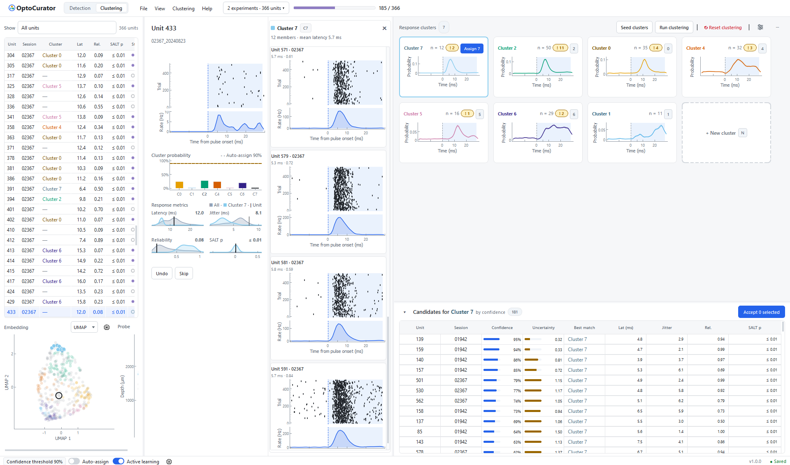

# OptoCurator

OptoCurator is an open-source desktop GUI application for the detection and interactive clustering of optotagged cells.



## Installation

Python ≥ 3.10

Create and activate the `optocurator` environment from `environment.yml`, then install the package:

```bash
git clone https://github.com/bramn22/OptoCurator
cd OptoCurator

conda env create -f environment.yml
conda activate optocurator
pip install .
```

Optional:
- UMAP 2D embedding support:
  ```bash
  pip install ".[umap]"
  ```

---

## Supported Input Formats

- **Phy / Kilosort session directory:**
  - Standard spike-sorting outputs (`spike_times.npy`, `spike_clusters.npy`, `spike_templates.npy`, `templates.npy`, `cluster_info.tsv`, `channel_positions.npy`, `channel_map.npy`, `params.py`).
  - **Important**: Optogenetic stimulation timestamps. The timestamps file must be named `opto_idxs_<protocol_name>.npy` or `opto_idxs_<protocol_name>.mat`. The timestamps file must contain a 2D array (N x 2) with pulse onsets (first column) and pulse offsets (second column). These need to be expressed in sample indices (same as `spike_times.npy`).
- **Neurodata Without Borders (`.nwb`) file:**
  - Sorted units and optogenetic stimulus presentation/interval tables are read out via `h5py`, supporting multi-probe sessions and multiple stimulation protocols.

---

## Quick start

### Launching OptoCurator

Launch the desktop GUI from the terminal:

```bash
optocurator
```

OptoCurator works with a 2-phase workflow:
1. Detection phase: the user configures metric thresholds to detect optotagged cells. 
2. Clustering phase: the user interactively clusters optotagged cells based on their response properties.

### Phase 1: Optotagged Cell Detection
1. Open **Detection** mode from the Launcher.
2. Use **File → Load experiment folder** for a Phy/Kilosort directory or **File → Load NWB file** for an `.nwb` file. See more information about supported input formats above. 
3. Select the stimulus protocol from the **Protocol** dropdown in the header bar.
4. Inspect a unit's spike raster, PSTH, probe location, and light-evoked vs. spontaneous waveform if available.
5. Adjust optotagging detection thresholds to capture the cells of interest. Metric parameters are configurable via **Stats → Metric parameters**.
6. Override individual unit tags manually with `T` (or the toggle button) and revert criteria edits with `Ctrl+Z` if needed.
7. Click **Save** (`Ctrl+S`). This writes out `<session_id>_opto_curated.csv` (metrics and tagging decisions) and a `.npz` file with the tagged units’ spikes into the session folder. The clustering mode needs both.

### Phase 2: Response Clustering
1. Open **Clustering** mode from the Launcher dashboard.
2. Create a new project (**File → New project**) or open an existing project folder (**File → Open project**).
3. Add one or more session folders saved in Detection mode via **File → Add experiment**.
4. Configure features used for clustering and active learning via **Clustering → Feature settings**.
5. Optional: Seed initial response clusters with **Clustering → Seed clusters** or cluster the full dataset directly with **Clustering → Run clustering** (Agglomerative, K-Means, or GMM).
6. Enable **Active learning** in the status bar or **Clustering** menu to surface the highest-uncertainty unit (`G` to jump to the suggested unit), and assign units to clusters using keyboard hotkeys.
7. Optionally enable **Auto-assign** and tune the **Confidence threshold** to automatically label unassigned units that exceed your confidence cutoff.
8. Inspect and curate cells in an existing cluster by clicking on a cluster card. Merge clusters by shift-dragging one cluster card onto another.
9. Save your project with `Ctrl+S`. This writes out two files: 
    - `clustering_project.yaml`: Project manifest storing linked experiment paths, cluster definitions (names, colors, hotkeys, order), feature/clustering parameters, and curation state. 
    - `pooled_units_curated.csv`: Pooled unit table across all included sessions with assigned `cluster_id`, cluster labels, curation status, and confidence scores.


### Keyboard Shortcuts
#### Detection
| Shortcut | Action |
|---|---|
|`T` | Mark focused unit as tagged / untagged |
|`Ctrl+Z` | Undo criteria change |

#### Clustering
| Shortcut | Action |
|---|---|
|`1`–`9`, `0`, `Q`, `W`, `E`, `R`, `T` | Assign focused unit to corresponding cluster |
|`N` | Assign focused unit to a new cluster |
|`Backspace` | Unassign focused unit |
|`Ctrl+Z` / `Ctrl+Y` | Undo / Redo curation action |
|`Space` | Skip focused unit |
|`G` | Go to active-learning suggested unit |